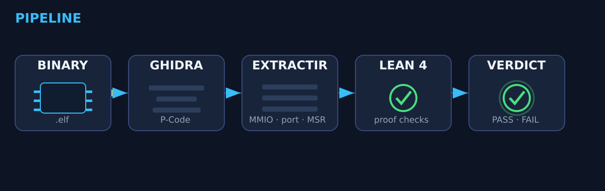
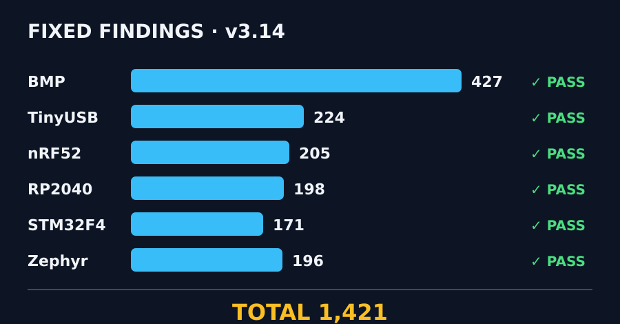
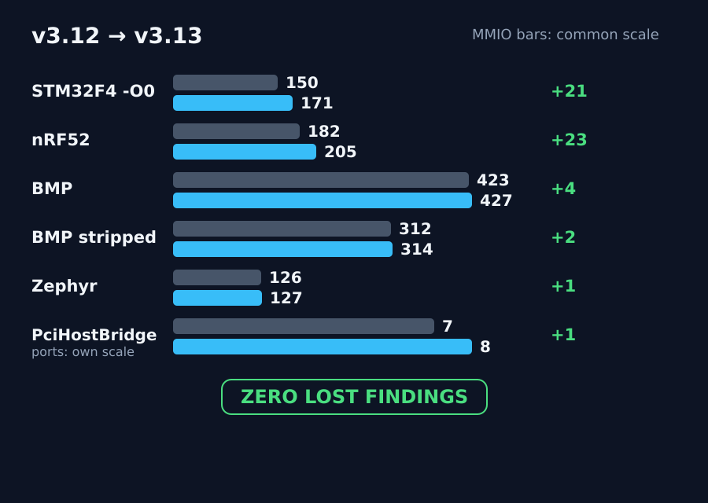
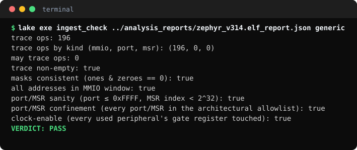
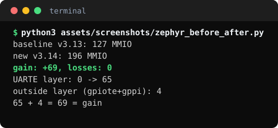
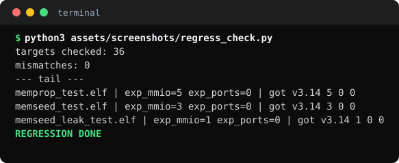
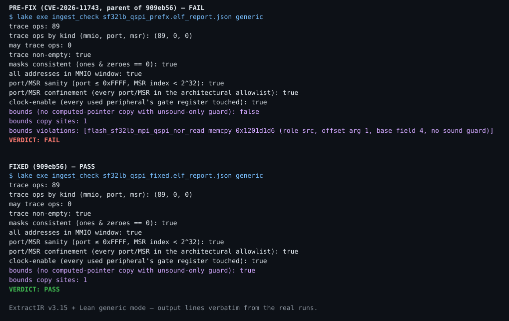
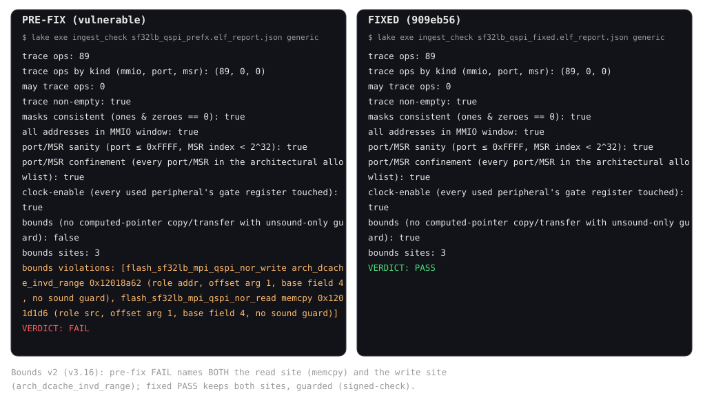
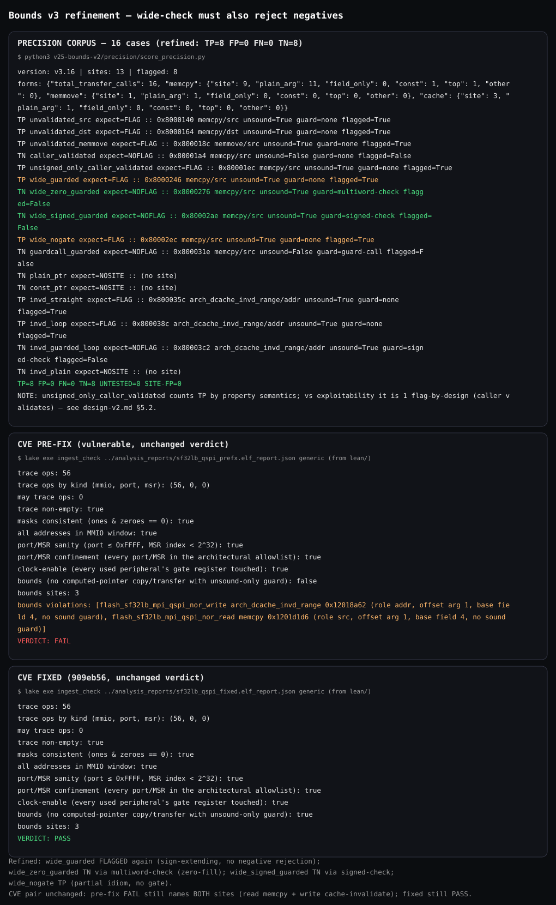

# Firmware Liberation Engine

   

Take a closed firmware binary, extract every hardware address it can touch,
and machine-check the result with Lean 4 — no execution, no guessing.

> **This is a static proof tool. It does not execute firmware and does not claim to find all vulnerabilities. PASS does not mean firmware is secure.**




## What it does

- Lifts firmware to Ghidra P-Code and resolves hardware addresses statically:
  literal pools, CFG-fixpoint register tracking, per-site argument binding,
  stack-slot tracking, direct-branch tail-call sites, .rodata
  device-config/API-struct resolution (v3.14, Zephyr device-API).
- Emits a JSON fact file: fixed MMIO / port / MSR accesses, may-access sets,
  protocol-call edges, BAR-relative provenance.
- Checks the facts with Lean 4: in-window addresses, driver confinement
  (each driver family touches only its own peripherals), port/MSR
  confinement against an architectural allowlist, and clock-enable-before-use
  (every used STM32 peripheral's gate register touched, generic mode).

## What it does not do

- It does not execute firmware, find all vulnerabilities, or prove firmware
  secure. A PASS means only that what was found stayed inside its allowed
  window.
- It does not flash, unlock, or modify any device, and it takes no firmware
  uploads — there is no upload form anywhere in this project.

## Results (extractor v3.14)

| Target | Fixed findings | May | Lean verdict |
|---|---|---|---|
| Black Magic Probe v2.0.0 (ARM) | 427 MMIO | 7 sites / 13 addrs | bmp PASS, generic PASS |
| RP2040 hello_uart | 198 MMIO | 0 | generic PASS |
| STM32F4 UART (-O0) | 171 MMIO | 0 | generic PASS |
| nRF52 UART (-O3) | 205 MMIO | 0 | generic PASS |
| TinyUSB cdc_msc (RP2040) | 224 MMIO | 0 | generic PASS |
| Zephyr echo_bot (nRF52840) | 196 MMIO | 0 | generic PASS |
| Black Magic Probe, stripped | 314 MMIO | 5 sites / 9 addrs | generic PASS only (never bmp mode on stripped input) |
| OVMF UEFI drivers (7 images) | 0 fixed MMIO · 27 ports · 2 MSRs | 0 | DxeCore / PciBus / PciHostBridge / QemuVideo PASS; Sata / Virtio FAIL (empty trace) |
| **Corpus total (6 stacks)** | **1,421** | | |





**v3.13 changes:** Slice 1 stack-slot tracking (STM32F4 -O0 +21, the GPIO
plane), Slice 4 direct-branch tail-call sites (nRF52 +23 TX path, BMP +4
TIM3/TIM1 pairs, PciHostBridge +1 port 0x510). Zero findings lost on all
25 regression fixtures. USART2 is still missing — see Limitations.

**v3.14 changes:** device-API resolver — `.rodata` device-config/API structs
seed per-site clones with the peripheral base, so Zephyr's UARTE driver layer
resolves through device-API indirect dispatch. Zephyr 127 -> 196 (+69, zero
lost, 10 gain functions, same ELF). UARTE layer 0 -> 65 (live 44/54; PSEL 4/4;
GPIO tail 0/10 missed — the pin array flows through a lookup out-parameter
and the loop join destroys per-pin values). Full regression exact on 36
targets, Lean sweep zero flips. Corpus 1,352 -> 1,421. Version bumped
v3.13 -> v3.14 because outputs changed on existing corpora.

**v3.15 changes:** bounds property — a CFG must-fixpoint provenance scan
records computed-pointer copy sites (memcpy/memmove where a pointer
argument is `ADD(struct-field, function-argument offset)`), the
unsound-check shape (unsigned `(offset + size)` vs the same struct's
size field), and sound-guard evidence (signed offset-vs-0, wide
ZEXT/SEXT, or guard-call). New JSON fields per function (`copy_sites`,
`copy_site_count`, `bounds_flagged_count`) and top level (`copy_sites`,
`copy_site_total`, `bounds_flagged_total`); Lean generic mode gains a
bounds verdict line. Proof pair: CVE-2026-11743 pre-fix firmware FAILs
on the read site (no sound guard), fixed firmware (909eb56) PASSes
(same site, `signed-check` guard). The CVE write path (DMA/cache
maintenance, not a CPU copy) is out of scope for v1. Version bumped
v3.14 -> v3.15 because report JSON gains fields. (Full design notes are
kept in local working notes, not in the repo.)

**v3.16 changes:** bounds write-path coverage + precision measurement.
Copy sites now also include cache-range transfers (`arch_dcache_invd_range`
and siblings, role `addr`, arg0 only) with loop-carried offsets via new
`ROOT(n)` provenance (ARG plus unknown loop accumulation); the fixpoint
now sweeps in reverse postorder (a listing-order bug poisoned the fixed
write's loop to the empty fixpoint). Proof pair extended: CVE-2026-11743
pre-fix FAILs naming BOTH the read site (memcpy) and the write site
(cache invalidate, no sound guard); fixed firmware PASSes with both sites
guarded (`signed-check`). Precision measured on a synthetic ground-truth
corpus (labeled, not real firmware): TP=6, FP=1, FN=0, TN=6 — the one FP
(`wide_guarded`: a 64-bit check lowering to a multi-word compare on 32-bit
ARM) needs multi-word compare recognition, a v3 item. A corpus-wide census
(new permanent JSON field `transfer_call_forms`) shows why v1 could never
be validated on the corpus: 47 transfer calls, zero FIELD+ARG copies, and
TOP-heavy provenance. Deliberately excluded from v2: DMA reload calls and
command-address programming. Version bumped v3.15 -> v3.16 because report
JSON gains a field and sites gain new kinds/roles.

**v3.17 changes:** bounds wide-check now requires negative rejection. A
64-bit check counts as a sound guard only when it also rejects negative
offsets: zero-extending widening (the offset is converted to unsigned
first, so negatives become huge and the sum check rejects them) or a
signed offset-vs-0 check alongside the wide sum. Sign-extending widening
alone flags again: the `wide_guarded` shape (`(unsigned long long)off + n
> size` with signed `off`) lets off=-1, n=16 wrap to 15 and pass, copying
one byte below base. The matcher distinguishes the widening form from the
lowering (zero-fill `movs`/`adc` vs sign-propagating `asr`), and the EXT
kinds split into ZEXT (sound) vs SEXT (unsound). Precision on the synthetic
ground-truth corpus (now 16 cases, labeled, not real firmware): TP=8, FP=0,
FN=0, TN=8 — `wide_guarded` flagged, zero-extending and signed+wide cases
unflagged, partial idiom (compare + SBCS, no gating branch) flagged.
CVE-2026-11743 pair unchanged: pre-fix FAILs naming both sites, fixed
PASSes. Full regression exact on 36 targets, zero bounds flips. Pipeline
hardening (no published number changes): every run now saves its full
headless log, reinstalls verify the Ghidra tree instead of trusting the
launcher, and a post-reinstall x86_blink canary (11 MMIO) fails loudly on a
damaged install — after a fresh Ghidra install was found to silently lack
Decompiler Switch Analysis and recover less code until diagnosed. Version
bumped v3.16 -> v3.17 because guard semantics changed on the wide-check
input class.

**Clock-enable-before-use (Lean-side, generic mode; no extractor change, no
JSON change, no new flags):** every MUST access to a mapped STM32 peripheral's
register block requires a MUST STORE to that peripheral's clock-gate register
somewhere in the trace, printed as a `clock-enable` verdict line with a named
violation line. Synthetic violation (built firmware, TIM3 clock only + GPIOA
use) FAILs exactly: `clock-enable violations: [main mmio 0x4001080c (GPIOA
needs 0x40021018 bit 2)]`; control (GPIOA clock + GPIOA use) PASSes;
blink/BMP/F4 PASS. Honest v1 limits: order-free (gate touch anywhere in the
trace, not must-precede — BMP proves file order is not execution order);
register granularity, not bit granularity (a bit-precise check would
false-FAIL BMP, whose generic `rcc_periph_clock_enable` helper resolves only
3 gate bits in must); no-RCC firmware is vacuous PASS (the maps activate on
gate touch, which is also what keeps non-STM32 targets safe); F4 USART2
invisible (Gap B); enable→disable→use (LPUART shape) NOT caught.

## Screenshots (real terminal output)

Terminal captures (SVG) of verbatim output from real runs — not mockups, not
diagrams. Binary PNGs cannot be pushed (the push tooling builds a UTF-8
snapshot), so the captures are rendered as SVG; the text inside each one is
copied byte-for-byte from the command shown, and the helper scripts live
next to the captures.


Fresh `lake exe ingest_check ../analysis_reports/zephyr_v314.elf_report.json generic` (run from `lean/`): trace 196, clock-enable true, VERDICT: PASS.


Computed from the v3.13 baseline and v3.14 Zephyr report JSONs (`python3 assets/screenshots/zephyr_before_after.py`, run from the repo root): 127 → 196, UARTE layer 0 → 65, gain +69 with zero losses.


Fresh recount of the v3.14 regression log (`python3 assets/screenshots/regress_check.py`, run from the repo root): 36 targets checked, 0 mismatches.


v3.15 bounds verdict on CVE-2026-11743 firmware (`lake exe ingest_check <report> generic`, run from `lean/`): pre-fix FAILs naming the vulnerable read site (`flash_sf32lb_mpi_qspi_nor_read memcpy 0x1201d1d6, no sound guard`); fixed firmware (909eb56) PASSes with the same site guarded (`signed-check`).


v3.16 bounds verdict on the same CVE pair: pre-fix FAILs naming BOTH the read site (memcpy) and the write site (`flash_sf32lb_mpi_qspi_nor_write arch_dcache_invd_range 0x12018a62, no sound guard`); fixed firmware PASSes with both sites guarded.


v3.17 bounds verdict on the same CVE pair (unchanged: pre-fix FAILs naming BOTH sites, fixed PASSes), plus the refined precision pane: `wide_guarded` flagged again (sign-extending, no negative rejection), zero-extending and signed+wide cases unflagged, TP=8 FP=0 FN=0 TN=8.

## Honest zeros

- **OVMF fixed MMIO: 0.** UEFI drivers reach hardware through protocols and
  runtime-discovered BAR bases, not fixed-band MMIO. What is recovered:
  27 port findings across 7 images (DxeCore 11, PciBus 2, PciHostBridge 8,
  QemuVideo PE 3 + TE 3, Sata 0, Virtio 0; 24 across 6 drivers counting the
  PE/TE twin once), 2 MSRs, and protocol-call provenance.
- **Real violations found: 0.** No real firmware has produced a confinement
  FAIL yet. The FAILs that exist are the synthetic demo below and
  Sata/Virtio's genuinely-empty traces.
- **Synthetic confinement demo (SYNTHETIC, not a found violation):** ARM
  driver-confinement bmp FAIL (`rcc_syndemo_touch` touches GPIOA
  0x4001080c) with control PASS; x86 port-confinement generic FAIL
  [`syndemo_bad_port` port 0x1234] with control COM1 PASS. Both shapes
  preserved in v3.13 and v3.14. Clock-enable demo (SYNTHETIC, same rule):
  built firmware with TIM3 clock only + GPIOA use FAILs exactly
  [`main mmio 0x4001080c (GPIOA needs 0x40021018 bit 2)`] with control
  (GPIOA clock + GPIOA use) PASS.
- **PciHostBridge (resolved, not a finding):** its ports 0x510/0x514/0x518
  are QEMU fw_cfg (0x510 selector, 0x511 data, 0x514 DMA address high,
  0x518 DMA address low/trigger), identified from the binary (OUT
  immediates feeding the generic IoWrite32 helper, high-then-low 32-bit
  writes plus control poll) and the QEMU fw_cfg spec (DMA base 0x514).
  The Lean allowlist grants the four named ports only, not the
  0x510–0x518 range, and PciHostBridge now PASSES. Closing an allowlist
  gap is not finding a bug.

## What it proves today

- **Extraction**: Ghidra P-Code + a CFG fixpoint register tracker (v3.1)
  resolves ARM MMIO addresses that never appear literally in the code
  (literal-pool load → register → STORE/LOAD). States flow along CFG edges
  and merge on conflict (exact values become unknown, bit masks AND-merge),
  so one branch's value can no longer leak into another branch's access —
  the v3 linear scan was proven to do exactly that on BMP `renesas_uid`.
  Verified 10/10 on a ground-truth STM32F4 blink firmware we built ourselves.
- **MAY-analysis (v3.2)**: a second fixpoint over the same CFG whose join
  is UNION (finite value sets, capped at 16; argument-dependent values are
  TOP and claimed nowhere). A LOAD/STORE the must-analysis drops because
  its address is path-dependent is recorded as a MAY-access with the full
  set of possible MMIO addresses — an audit must know what a driver
  COULD touch, not only what it must touch. On BMP it recovers 7 sites
  (13 addresses), including `aux_serial_init`'s true pair
  {USART1_CR1, USART2_CR1} (v3 claimed USART1 alone) and the
  `platform_nrst_get_val` pair {GPIOA_IDR, GPIOC_IDR}.
- **Jump-table recovery (v3.3)**: Ghidra's ARM TBB/TBH P-Code shape
  (table LOAD + ZEXT + x2 + table base -> pc -> BRANCHIND) is recognised,
  the table is read from program memory, and every entry's target that is
  a real instruction start in the same function becomes a CFG successor
  (both fixpoints share the map). On BMP this restores 22 must-accesses
  with 0 dropped, including the `rcc_*` oscillator cases and
  `remote_packet_process`'s GPIOB stores.
- **Call-graph recovery (v3.4)**: pointer-table dispatch is recovered
  from a backward slice (single constant target, or a constant-base
  table of 4-byte pointers with the base allowed in a register via
  `adr`). Entries that are real function entries become call-graph
  edges (`indirect_calls`); entries that are instruction starts in the
  same function become CFG successors (computed goto, BRANCHIND only).
  On BMP this finds 10 pointer-table sites / 57 successors across 8
  functions — and, honestly, 0 function-entry edges: BMP's indirect
  calls are vtable/struct-based (argument-dependent, left for points-to
  analysis), while its tables are all intra-function gotos. Must 235 /
  may 8 are unchanged (the newly reached blocks hold no MMIO), but the
  CFG is now complete across computed jumps too.
- **Points-to recovery (v3.5)**: the CALLINDs v3.4 could not resolve
  (BMP: 161 of 178 are `LOAD [struct + const offset]` — vtable-style
  dispatch) are resolved to **may-call-edges**. Each pointer load is
  followed through its backward def chain (COPY / INT_ADD / LOAD of a
  resolvable address, depth 4), where a varnode in a memory space reads
  as the word at that address (ARM literal-pool pattern). A chain ending
  in flash yields the static word; a chain ending in RAM (BMP's probe
  structs live in `.bss`, filled at runtime) is matched against a
  whole-program store map of every runtime store of a resolvable
  function address, keyed by exact address or field offset. On BMP:
  **159 of 178 CALLINDs resolved** (1216 may-targets, avg 7.6/site —
  44 sites exact with a single target, e.g. `cmd_tdi_low_reset` →
  `jtagtap_next`; the wide sets are one ops-table field shared by a
  whole driver family, e.g. all 20 `*_attach` functions, which is sound
  but coarse — struct-type sensitivity is the known refinement);
  **19 unresolved** (parameter-passed struct pointers, `[reg + reg]`
  indexing, longer chains), counted, never guessed. Must 235 / may 8
  unchanged — points-to touches no fixpoint.
- **Value export (v3)**: every MMIO access carries `value` (exact or null)
  plus `value_known_ones` / `value_known_zeroes` bit masks, so
  read-modify-write stores still yield provable bit effects.
- **Lean checks** (`lean/` Lake project, exe `ingest_check`):
  - `blink` — clock+mode before LED, LED bit decided, clock bit set,
    mode clear-then-set (theorem version: `Verifier/BlinkProof.lean`)
  - `generic` — trace non-empty, masks consistent, all addresses in the
    MMIO window, port/MSR confinement, clock-enable-before-use
  - `bmp` — **driver confinement**: each driver family touches only its
    own peripherals (see below)

## Real-firmware result: Black Magic Probe v2.0.0

`blackmagic-native-v2_0_0.elf` (1.23 MB, ARM, 1034 functions) through the
full pipeline under a 512 MB Ghidra heap:

| Check | Result |
|---|---|
| MMIO accesses extracted | 427 (0 truncated at the 5000-op cap, all functions fixpoint-converged) |
| Driver confinement | **PASS** — jtagtap 56+ (GPIO/AFIO only), rcc 28+ (RCC only), st_usbfs 24 (USB only), swdptap 37 (GPIOA only), LED 2 (GPIOB only), platform 29 (GPIO/ADC only); recovered TBB cases stay within their families |
| MAY-accesses (possible, not certain) | 7 sites, 13 addresses — see the MAY section in the register map |
| MAY confinement (every possible address within its family) | **PASS** (v3.7). The one case v3.5 flagged (`rcc_get_usart_clk_freq` may read USART1_CR1) was verified by the source cross-check as a **false positive** — the flagged `LOAD` reads RAM globals (`0x20001108`/`0x2000110c`, the `rcc_apbX_frequency` variables), not USART1 — and the v3.7 provenance + taint filter removed it. The profile stays strict; no adjudication needed |
| Indirect-call resolution (points-to, v3.5) | **159/178 CALLINDs resolved as may-sets** (1216 targets; 44 exact singletons, e.g. `cmd_tdi_low_reset` → `jtagtap_next`; wide sets = one ops-table field shared by a driver family); 19 unresolved, counted; certain edges 0 (the one single-const case resolves to 0x16, not a function) |
| Source cross-check (v3.5 vs BMP v2.0.0 source) | **Singletons 44/44 exact, 0 mismatches; field truth 99/116 (85%) covered.** 17 misses in three explained classes: tail calls (6 — reset/halt dispatch compiles to `BRANCHIND`, not `CALLIND`), store-visibility gap (11 — function-pointer literals present in the image but no `LOAD` of them in any function pcode), the no-op stub (1). The 19 unresolved are classified (libc/stdio, parameter callbacks, vector table) — none are BMP driver ops. Full report: [`bmp_source_crosscheck.md`](bmp_source_crosscheck.md) |
| Tail-call recovery + literal scan (v3.6) | **Field truth now 116/116 (100%).** 43 tail-call sites / 399 targets recovered (`target_reset` → `cortexm_reset` + `samd_reset`, halt family exact); whole-image literal scan (157 stored pointers, name-attributed) + dual store recording (exact address AND field offset) closed the remaining 11 store-visibility misses. CALLIND may-sets: 159 sites, 1930 targets (v3.5: 1216), zero v3.5 targets lost. Unresolved tail calls: 4 (USB/parameter callbacks). Lean BMP still FAILs only on the known rcc may-FP (fix is next, not v3.6). |
| May false-positive fix (v3.7) | **Lean BMP now PASSES fully (must + may confinement).** May-state values carry provenance; recording drops a value only when a feasibility-aware taint BFS proves no path carries it to the use. The rcc USART1 flag is gone (may sites 8→7, addresses 14→13); the first filter draft wrongly dropped two TRUE values (`aux_serial_init` USART1, `platform_init` GPIOB) and was caught by source verification before shipping — the shipped taint version keeps both. Must 235, CALLIND 159/1930, tail 43/399 all unchanged. |
| Negative tests | Tampered reports **FAIL** as required (confinement violation, mask overlap) |
| Register map | [`blackmagic_registermap.md`](blackmagic_registermap.md) — 35 registers, all labelled from the public STM32F1 map |
| Local-vs-target classifier | [`classify_mmio.py`](classify_mmio.py) + chip profiles — BMP: 427 known / **0 suspects**, may addresses 13 known / **0 suspects**; STM32F4 UART (v3.13, reconciled profile): 164 known / 7 suspects (bit-band aliases only — a profile gap, not extractor error) |
| SVD importer | [`svd_import.py`](svd_import.py) — CMSIS-SVD → chip profile JSON (`python3 svd_import.py <device.svd> <profile.json>`). Generated STM32F103 profile reproduces the hand-written verdict on BMP: 235 known / 0 suspects, may 13 / 0. |
| RISC-V support | `RiscVIsa` (RV32) — auto-selected by Ghidra language. Verified on `targets/riscv_blink` built from source: 18 trace ops, may 0, Lean generic PASS; ARM output unchanged. Test ELFs ship base64-encoded (`.b64`, decode like the blink fixture). |
| Stripped binaries | No code change needed — the engine uses Ghidra auto-analysis, never debug info. Stripped BMP: 314 vs 427 must (−26%), may 9 vs 13, 0 suspects, Lean generic PASS; stripped blink: zero loss (10/10). **Stripped binaries must use generic mode only** — `bmp` mode passes vacuously on stripped input (`FUN_` names fall through) and proves nothing. Reproduce with [`elf_strip.py`](elf_strip.py) on the official BMP release ELF. |
| MIPS support | `MipsIsa` (MIPS32 BE+LE) — auto-selected by Ghidra language. Verified on `targets/mips_blink` built from source: 14 trace ops, may 0, 2 certain indirect edges, Lean generic PASS (the report carries the platform's MMIO bands in `mmio_windows`; old reports fall back to the ARM window); ARM output unchanged. Test ELF ships base64-encoded (`.b64`). |
| x86 support (v3.8) | `X86Isa` (x86-64 first; 32-bit structural only, untested) — auto-selected by Ghidra language; PE verified, TE supported via the custom TeLoader (v1, see TE row). Signature-driven calling conventions (per-callee Ghidra signature, binary default PE→Windows / ELF→System V, `abi=` override, SysV union only for unknown callees); overlapping registers handled by conservative full-register invalidation + derive-contained-views + slice-aware reads (not per-byte tracking). Port I/O (`port_io_accesses`) and MSRs (`msr_accesses`) are separate JSON classes; PCI config ports fall out raw (BDF decoding is v2). Verified on `targets/x86_blink` built from source: 11 MMIO, may 0, 2 port, 3 MSR, 2 certain indirect edges, Lean generic PASS, trace 16 (11 MMIO, 2 port, 3 MSR). OVMF corpus (EDK2 2025.11, 6 DXE drivers incl. DxeCore, 411 functions — DxeCore alone is 254): no crashes, but 0 fixed-band MMIO — real UEFI code reaches hardware via protocol calls, parameter-port helpers, and runtime-discovered BARs, so inter-procedural constant propagation shipped in v3.9 (OVMF unchanged — see v3.9 row); protocol-aware points-to shipped in v3.10 (see v3.10 row); ACPI-derived bands implemented (MCFG-only) but dormant on OVMF — no tables in image, see ACPI row; Lean generic on OVMF reports: DxeCore, QemuVideo PASS (their port/MSR findings now enter the trace — v2 item #1, Lean-side only, extractor now v3.10); PciBus now PASSES too (v3.10 protocol findings); PciHostBridge FAILED on confinement at v3.12–v3.13 (genuine ports 0x514/0x518, then [0x510, 0x514, 0x518], outside the allowlist — see v3.12/v3.13 rows) and now PASSES: the three ports are QEMU fw_cfg (0x510 selector, 0x511 data, 0x514 DMA address high, 0x518 DMA address low/trigger), and the Lean allowlist grants the four named ports — see fw_cfg row; SataController, VirtioBlk still fail on genuinely-empty trace. Port/MSR sanity enforced (port ≤ 0xFFFF, MSR index < 2^32); port/MSR confinement shipped (Lean-side, see confinement row). Real mode (16-bit) assessed, still open. Test ELF ships base64-encoded (`.b64`). |
| Inter-procedural constant propagation (v3.9) | Extractor-side only, JSON shape unchanged. Exact argument-register constants propagate across direct calls when EVERY direct call site agrees (else unknown, never guessed; since retprop, meetOverSites also binds when all sites agree on the same BAR/BASE symbol); guarded by: all Ghidra callers direct, callee never address-taken, never a tail-call target, x86-64 convention known (unknown convention ⇒ unmodelled, never the clobber union). ARM BMP must 235 → 346 (v3.9) → 422 (v3.11, per-site) → 423 (v3.12, clobber) (libopencm3 peripheral helpers with consistent bases: adc/dma/flash/gpio/rcc/timer; 0 accesses lost, may 7/13 unchanged, classifier 423/0); stripped BMP 198 → 241 (v3.9) → 312 (v3.11, per-site). OVMF unchanged (0 MMIO / 2 port / 1 MSR): UEFI BARs flow through protocols and memory, not constant arguments — memory propagation and protocol-aware points-to remain. Lean: all previous PASS verdicts hold (BMP bmp PASS at 423/13). Soundness fixture: targets/x86_constprop_test. |
| Protocol-aware points-to (v3.10) | x86-64 UEFI only. Boot Services interface acquisition (Locate/Handle/OpenProtocol, InstallMultiple variadic pairs), embedded-interface + parameter tracking, member-call resolution to PciIo/PciRootBridgeIo methods. Pci.Read/Write attributed to PCI config cycles (OUT 0xCF8 + IN/OUT 0xCFC); all other methods recorded as visible protocol-call edges, never fabricated accesses. PciBusDxe 0 → 2 port findings + 50 protocol edges, unresolved 195 → 145; DxeCore 94 → 73, PciHostBridge 32 → 23, QemuVideo 6 → 2; no regressions on any other corpus (all v3.9 numbers byte-identical). Soundness: a protocol call resolves only when interface identity AND method offset are certain (GUID-resolved or single-implementation); ambiguous calls stay unresolved/may — FUN_00002154's 9 unknown-interface member calls gain zero findings. Caveat: protocol-attributed port entries record the engine's generic size (4); the Width argument is not decoded (PciBus Pci.Write at 0x682f is Width=0/Uint8, so the true CFC phase is 1 byte). ECAM-only platforms differ from the CF8/CFC mechanism attributed here. |
| ACPI-derived bands (MCFG) | Extractor-side, x86 branch only, JSON shape unchanged. The input image is signature-scanned for a valid ACPI MCFG table (signature + exact length arithmetic + checksum + sane allocations); derived ECAM bands [base, base + nBuses*1MB) are unioned into mmio_windows, else static x86 bands (explicit mmio= suppresses augmentation). OVMF result: NO bands derived — OVMF_CODE_4M.fd contains no ACPI tables at all (tables are QEMU runtime artifacts via fw_cfg; the installer driver QemuFwCfgAcpiPlatform contains no MCFG string, no 0xB0000000 immediate, no RSDP). Validated on synthetic carriers (non-default base 0xE0000000 → band [0xE0000000, 0xE0200000); corrupted checksum/length fall back to static bands). Test fixtures: targets/acpi_mcfg_test. DSDT/SSDT OperationRegions remain future work (need an AML parser; no DSDT/SSDT exists in this image anyway). Version stays v3.10: outputs unchanged on all real corpora. |
| TE loader (v1) | Custom Ghidra loader (Java, Ghidra 11.4.2 API) for UEFI TE ("VZ") images — the last v2 item, loader work, not extractor work. Parses the TE header per the UEFI PI spec, maps sections exactly from file bytes at ImageBase + VirtualAddress, registers the header entry point; no bytes invented, no relocations applied (image loads at its header base). QemuVideoDxe.te validates at full PE parity: 13 functions, port 3 (OUT 0xCF8 + IN CF8/CFC at 000016d6 since v3.12), unres 2, proto 4 — access sets identical to the PE twin, zero TE-only findings (entry function is FUN_00002396 vs PE's "entry" name only). Corrupted TEs (bad magic, truncated section table, section past EOF) fail import cleanly. Extractor unchanged by this loader work; loader versioned separately as v1. Install: loaders/te/build.sh (see loaders/te/INSTALL.md). |
| Memory/global propagation (v3.10, dormant on real corpora) | Extractor-side, two layers feeding the existing must-fixpoint, JSON shape unchanged. Stage 1 (intra-procedural memState): a STORE to a known non-MMIO address records the value, an unknown non-stack store clears all of memState, CALLs clear memState, stack stores ignored (def-chain-proven SP/FP), MMIO stores never enter memState; LOADs consult memState before image bytes. Stage 2 (program-wide global seeds): a cell is seeded only when every overlapping store in the whole program targets exactly that cell with the same exact value, at least one store exists, no unknown non-stack store exists anywhere, and the address never leaks (call argument, stored value, return register). COPY-to/from-ram ops are the same operations in x86-64 dress (RIP-relative globals) and are handled identically — without this the slice would be vacuous on x86-64. Struct fields with a known-global base are covered automatically; heap-struct fields are out (object identity is the blocker — two devices' PciIo pointers share provenance but are different objects). OVMF result: ZERO new findings on all drivers (seeds=0 everywhere — unknown struct-pointer stores kill all seeds; BAR bases enter as hardware inputs from PCI config space, so no BAR constant ever enters memState). No regressions on any corpus (all v3.10 numbers semantically identical; only pre-existing call-list ordering nondeterminism in bytes). Soundness negatives proven on fixtures: may-aliasing stores and non-dominating (conditional) stores yield no must; disagreeing stores and leaked addresses block seeds. Test fixtures: targets/memprop_test, targets/memseed_test, targets/memseed_leak_test. Known pre-existing gap, not fixed here: 32-bit (u32) MMIO addressing on x86-64 lifts as INT_SEXT and sign-extends out of the bands. Version stays v3.10: outputs unchanged on all real corpora. |
| Config-space tracking (v3.10, extractor-side, additive `bar_relative_accesses` class) | CF8/CFC config-address resolution; BAR-register reads (BAR0-BAR5, offsets 0x10-0x24) yield BAR symbols carrying device BDF + BAR index; memory-BAR flag masking (base & ~0xF) yields BASE symbols; a BASE symbol + constant offset is recorded as a BAR-relative finding (device BDF, BAR index, offset) — a provenance statement, never a fixed address. MUST-class is forbidden for symbolic values; Lean ignores the additive class (verdicts unchanged). OVMF honest zero: QemuVideoDxe's config addresses are parameter-computed across helpers, PciBusDxe's CF8/CFC traffic is protocol-attributed, PciHostBridgeDxe has no direct CF8/CFC entries. Proven on synthetic fixture `targets/x86_cfgspace_test/` (3 positives, 4 soundness negatives). Out of slice: ECAM, 64-bit BAR pairs, return-value propagation (BAR symbols are intra-procedural only). Version stays v3.10: outputs unchanged on all real corpora. |
| Return-value propagation (v3.10, machinery proven, zero corpus change) | Direct-call return summaries — a callee's return-register value agreed on ALL RETURN ops (same exact constant, or same BAR/BASE symbol) is restored to the caller's return register after the clobber; argument dependence covered by the v3.9 all-sites-agree discipline, extended to agreed BAR/BASE symbols (meetOverSites); joint entry+summary iteration (cap 32, drop-all on non-convergence); recursion never yields an unsound summary; protocol interface returns (Phase P2, x86-64 only) use the same all-RETURNs-agree rule for IFACE provenance. Fixture `targets/x86_retprop_test/` proves all cases (const, nested const, agreed arg identity, arg+offset, path-varying negative, disagreeing-sites negative, recursion negative, BAR-symbol return, BAR-symbol+offset composition) with old-code control (1 MMIO/0 BAR) vs new (7 MMIO/2 BAR). On all real corpora outputs are unchanged (17/17 semantically identical, version stays v3.10): summaries form (BMP 196, stripped 105, DxeCore 16, PciBus 5) but no caller-side hardware address computation depends on them — OVMF returns carry status codes, not addresses, and QemuVideo's config flow is argument-carried, not return-carried; protocol summaries are 0 everywhere (UEFI interfaces flow via out-params/globals/struct fields, not returns). Out of slice: STRUCT returns, per-site transfer application (agree gate kept deliberately), indirect-call returns. |
| Struct return summaries (v3.10, no version bump — no existing-corpus output changed) | A callee that allocates a fresh struct and returns its pointer now yields per-call-site field summaries (constants, BAR/BASE symbols, interface provenance), gated by the same all-return-paths-agree rule as scalar returns; object identity is the call-site address, so two devices never share an identity and a cross-device leak is impossible by construction. Global-struct returns reuse the scalar/memprop path (exact address → image bytes / global cells); parameter-struct (out-param) fills are NOT covered. Fixture `targets/x86_struct_test/` (new code: MMIO 6, BAR 1, port 2, Lean generic PASS trace 8; old code: MMIO 1, port 2, BAR 0). OVMF honest zero: 0 struct summaries on all 7 drivers — device structs there arrive via parameters/out-params/globals, not struct-pointer returns. Also fixed two pre-existing gaps found by this fixture: 8-byte register-indirect image loads (were unknown) and COPY-to-ram absolute MMIO stores (were never recorded at emission). |
| u32/INT_SEXT MMIO recovery (v3.10, no version bump — no existing-corpus output changed) | A 32-bit MMIO address held in a u32 (bit 31 set) is widened on x86-64 through a signed int, so Ghidra lifts INT_SEXT and the address becomes 0xFFFFFFFFFED00000, outside every band. The fix recovers the low 32 bits ONLY when the Bits prove bits 63..32 are all copies of bit 31 (band-gated: a truncated value outside every band keeps today's behaviour, so nothing is band-shopped and no non-band memState key moves). Three layers were fixed, not one: (1) COPY-from-ram read a full 8-byte pointer even for 4-byte loads and threw at block ends — now size-correct reads; (2) INT_SEXT/INT_ZEXT with a folded global load (movslq mem, reg) resolved ram inputs to unknown — now image bytes like COPY-from-ram; (3) band-gated truncation at every address site (must emission, STORE/COPY-to-ram transfer, loadBits, gmem seed/leak scans, may filter, ports, MSR indices — MSR un-gated since indices are architecturally 32-bit). Fixture `targets/x86_u32_test/` (before: mmio 2; after: mmio 6, Lean generic PASS trace 6; all 3 soundness negatives absent: genuine 64-bit pointer, sext-not-in-band, unknown parameter). On all real corpora outputs are unchanged (0/20 identical, version stays v3.10): the regression corpora contain no u32-MMIO pattern (their globals are u64, their addresses constants). Out of slice: ARM/RISC-V/MIPS have no analogous path (all address varnodes 4 bytes; MIPS SEXTs are 1->4 value extensions); genuine-64-bit addresses whose upper bits happen to be all sign copies remain indistinguishable from sign-extended 32-bit addresses at the Bits level (documented residual). |
| Port/MSR confinement (Lean-side only, extractor v3.10 unchanged) | Generic mode now checks every port/MSR trace entry against an architectural allowlist selected by the report's `language` field (x86: PCI config 0xCF8–0xCFF, legacy PIC/PIT/DMA/keyboard/CMOS, serial COM1–COM4; Intel SDM architectural MSRs incl. APIC_BASE 0x1B and EFER 0xC0000080; AMD SYSCFG/HWCR/GHCB/SEV_STATUS). Non-allowlisted entries produce a distinct `confinement violations: [func kind 0xaddr, ...]` line and FAIL the verdict — never silently dropped, never silently passed. Non-x86 architectures and unknown language have no allowlist, so port/MSR entries there fail (no "everything passes" default). Protocol-attributed CF8/CFC ports pass by the architectural PCI range, with no exemption. Bmp/blink modes untouched. Verified at v3.10: all 7 OVMF drivers' verdicts unchanged (DxeCore IN 0xCFE, PciBus CF8/CFC, PciHostBridge RDMSR 0xC0010131, QemuVideo OUT 0xCF8 all pass with reason); PciHostBridge's verdict changed at v3.12 (see v3.12 row); all other Lean verdicts unchanged; synthetic negatives (port 0x1234, MSR 0xC0009999, COM1 port on an ARM report) all FAIL with named violations. Out of slice: profile-file/report-field allowlist extension (would need a new CLI argument or JSON field); device-register ports (parallel/VGA/IDE/floppy) go through the documented source-edit allowlist path. |
| v3.11 — per-site transfer (extractor) | A callee is analyzed separately per distinct argument-binding group instead of one all-sites-agree summary, so a helper called with different arguments at different sites resolves per site. Clone per binding equivalence class (not per call site); clones never merge back into a shared summary; findings recorded under the callee, deduped by (instr, location); recursion via intra-procedural clones (inner CALLs use merged summaries; self-sites skipped); caps 32 groups/callee, 1024 clones total, excess groups fall back to merged/unknown (never a guessed value). Constants + BAR/BASE symbols flow per-site; struct/interface provenance per-site is future work. BMP 346 -> 422 (+76, all libopencm3 parameter helpers, source-verified e.g. dma_channel_reset channel-5 registers), stripped 241 -> 312, constprop 2 -> 3, u32 6 -> 8, zero findings lost anywhere. QemuVideoDxe UNCHANGED (0/1/0): per-site splits its generic helper into CF8 and CFC clones, but the IN stays unknown because the intervening CALL clobbers RCX — the actual unlock is callee clobber refinement (shipped in v3.12, see next row). On BMP the global clone cap binds (1024 clones, 1213 groups skipped, sound fallback to merged/unknown). Fixture `targets/x86_persite_test/` (new code: MMIO 7, port 7, BAR 2, Lean generic PASS trace 14; old code: MMIO 1, port 5, BAR 0). Version bumped v3.10 -> v3.11 because outputs changed on existing corpora. |
| v3.12 — callee clobber refinement (extractor) | A direct CALL now clobbers only the registers the callee may actually write on some path (per-callee may-write sets over the call graph, all-paths rule; indirect calls stay fully conservative; caller-saved values provably surviving a call are preserved). This is the measured QemuVideoDxe unlock: the generic helper's IN at 000016d6 now resolves to CF8 and CFC per site (port 1 → 3, PE and TE twin identical, Lean generic PASS trace 3). Same shape unlocks DxeCore's generic IO helpers (port 1 → 11: COM1 block 0x3f8–0x3fd plus PCI CF8/CFC) and PciHostBridge's (port 0 → 7, incl. literal-immediate sites at 0x514/0x518 — see confinement note). BMP 422 → 423 (new ADC1_CR2 LOAD in adc_is_calibrating, source-verified in libopencm3). Soundness negatives hold: one-path writes, mixed save/restore, and indirect-call callees all stay fully clobbered. Documented limit: balanced push/pop of a caller-saved register still counts as a write (save/restore analysis is future work). May/taint transfers deliberately left conservative. PciHostBridge confinement note: its Lean generic verdict is now FAIL on confinement, naming only 0x514/0x518 — new genuine findings outside the architectural allowlist; allowlist extension is a separate Lean-side decision pending identification of that device. (Resolved after v3.13: the device is QEMU fw_cfg, the allowlist was extended — see fw_cfg row; PciHostBridge now PASSES.) Fixture `targets/x86_clobber_test/` (new code: MMIO 1, port 4, Lean generic PASS trace 5; old code: MMIO 1, port 1). Version bumped v3.11 -> v3.12 because outputs changed on existing corpora. |
| v3.13 — stack-slot tracking + direct-branch tail-call sites (extractor) | Slice 1: stack slots (`SP:<func>:<delta>` symbols) flow through COPY/INT_ADD/INT_SUB; SP seeded at op 0, loop back-edges meet into it; `stk:` cells range-dropped on overlapping stores and dropped entirely on escape to non-stack memory or on CALLIND/unknown/tainted calls (a restricted "b-lite" rule keeps them across direct calls to known untainted callees unless an argument carries an SP symbol). Slice 4: `sitesByCallee` now accepts direct BRANCH ops to another function's entry alongside CALL ops, so helpers entered only via tail branches get binding sites — this is the nRF52 TX unlock (its TX functions were NOT stack-spilled; they had no binding site at all). STM32F4 -O0 150 -> 171 (+21 GPIO plane, all code-true), nRF52 182 -> 205 (+23), BMP 423 -> 427 (+4 TIM3_CR1/TIM1_BDTR pairs), stripped 312 -> 314, Zephyr 126 -> 127 (RTC1 CC[0]), F4 -O2 169 -> 171, PciHostBridge port 7 -> 8 (new 0x510 fw_cfg selector port; Lean generic FAIL now [0x510, 0x514, 0x518] — since resolved, see fw_cfg row). Corpus 1,303 -> 1,352; zero findings lost on all 25 fixtures. A third piece (entry-memory flow, `meetMemOnly`) was built, measured zero added and zero lost, and reverted — a sound change with no measured benefit does not ship. Gap B (USART2) NOT fixed: indexed AFR stores in HAL_GPIO_Init must drop-all (base + unbounded runtime pin index can wrap to any address including RAM) and the `__udivmoddi4` division chain blocks the handle-struct path; sound routes are redesigns (edge-translated closure, SARG seeding, per-site-clone summaries + re-run), not patches. Classifier profile reconciled: `stm32f4_profile.json` gains real EXTI (0x40013C00–0x40014000) and PWR (0x40007000–0x40007400) blocks from the STM32F407 SVD — F4 v3.13 now classifies 164 known / 7 suspects (bit-band aliases only). Version bumped v3.12 -> v3.13 because outputs changed on existing corpora.
| QEMU fw_cfg allowlist (Lean-side, generic mode) | PciHostBridgeDxe's ports 0x510/0x514/0x518 identified from the binary: OUT immediates at 0x2f30 (`mov $0x514`) and 0x2f43 (`mov $0x518`) feeding the generic IoWrite32 helper, high 32 bits then low 32 bits of a `FwCfgDmaAccess` struct address, then a control-field completion poll — exactly the QEMU fw_cfg DMA protocol (spec DMA base 0x514; 64-bit register, low-half write triggers). The driver reads `etc/hardware-info` and `etc/extra-pci-roots` through QemuFwCfgLib, which is why the DMA routine is linked in at all. `x86PortAllowed` now grants the four named ports (0x510 selector, 0x511 data, 0x514 DMA high, 0x518 DMA low/trigger), NOT the 0x510–0x518 range (the in-between ports are unassigned padding). PciHostBridge FAIL [0x510, 0x514, 0x518] -> PASS (all 3 report variants); synthetic bad-port control still FAILs on 0x1234 (no hole opened); full OVMF sweep otherwise unchanged (Sata/Virtio still FAIL on empty trace, pre-existing). This is an allowlist gap closed, not a finding — never cite it as one. No version bump: verifier-only change, extractor untouched.
| Clock-enable-before-use (Lean-side, generic mode) | Generalization of the blink theorem: every MUST access to a mapped STM32 peripheral's register block requires a MUST STORE to that peripheral's clock-gate register somewhere in the trace (ClockGate tables for STM32F1/RM0008 and STM32F4/RM0090, cross-checked against the Keil STM32F407 SVD: all 31 block ranges match). New `clock-enable` verdict line plus a named violation line under existing `generic` mode — no extractor change, no JSON change, no new flags or modes; `bmp`/`blink` modes untouched. PASS on blink, BMP (427), F4 -O0/-O2 (171), BMP stripped (314); synthetic violation (built firmware, TIM3 clock only + GPIOA use) FAILs exactly `[main mmio 0x4001080c (GPIOA needs 0x40021018 bit 2)]`, control PASSes; zero regression flips. Honest v1 limits, documented in code: order-free, not must-precede (BMP proves file order is not execution order); register granularity, not bit granularity; no-RCC firmware vacuous PASS (maps activate on gate touch — also what keeps non-STM32 targets safe); F4 USART2 invisible (Gap B); enable→disable→use (LPUART shape) NOT caught. Phase 2 (must-precede `gate_state_before` evidence + bit precision + `chip` field) needs a JSON-shape decision. Fixture `targets/arm_syndemo_clock/`. No version bump: verifier-only change.
| v3.14 — device-API resolver (extractor) | Zephyr's device-API indirection defeated by resolving `.rodata` device-config/API structs: the device struct yields the peripheral base, the API struct yields the driver functions, and per-site clones are seeded with the base so indirect dispatch resolves. Console: `devicesites: apiSites=9, apiSkipped=15, devInit=4, devIsr=1`. Zephyr 127 -> 196 (+69, zero lost, 10 gain functions, same ELF `96d7bae0635eee8d6b0e9bd5ee4881e6`, may 0, 269 functions). UARTE layer 0 -> 65 (live 44/54: init 14, PSEL 4, poll_out 7, is_tx_ready 1, isr 11, rx_enable 2, rx_ready 1, fifo_read 4 — all register-exact; missed 10/54 all pinctrl GPIO tail, loop-join cause; 21 extras are path-insensitive dead-block/dead-arm sites, recorded per the engine's address-known discipline, never pruned by branch feasibility; outside-layer gains gpiote 2 + gppi 2). One bug found and fixed during measurement: the first run's shape-only ISR validator accepted `arg=0` (the ARM vector table at address 0 "looks like" a struct) and seeded 46 bogus ISR clones — fixed by requiring ISR args to be members of the device set; bogus clones produced zero findings. Full regression exact on 36 targets (all v3.13 numbers reproduced, OVMF ports identical — the ISA-neutral resolver caused no x86 changes); Lean sweep zero flips (Zephyr PASS, clock-enable true). Still blind: non-live 21 functions (all-slots seeding is a parent decision — it changes a finding's meaning from called to callable), GPIO tail 10 (redesign), ISR→callback BRANCHIND link, stripped-binary enumeration (Slice B needs symbols). Version bumped v3.13 -> v3.14 because outputs changed on existing corpora. |

## Quickstart (any Linux box)

```bash
bash setup.sh                                   # JDK + Ghidra + Lean (asks for your sudo password)
export FIRMWARE_WORKSPACE="$PWD"               # required: the built-in default is the dev VM's path
export PATH="$HOME/.elan/bin:$PATH"            # Lean tools live here; repeat in every new shell

# Blink test (small STM32 firmware, built by us — ships base64-encoded, decode first):
base64 -d targets/stm32_blink/stm32_blink.elf.b64 > stm32_blink.elf
python3 ingest_and_analyze.py stm32_blink.elf --no-upload
cd lean && lake exe ingest_check ../analysis_reports/stm32_blink.elf_report.json blink
# expect: trace ops 10, may trace ops 0, VERDICT: PASS (first Lean build takes 2-5 min)

# Big test (real firmware, Black Magic Probe v2.0.0):
cd ..
python3 ingest_and_analyze.py <path/to/blackmagic-native-v2_0_0.elf> --no-upload
python3 classify_mmio.py analysis_reports/blackmagic-native-v2_0_0.elf_report.json stm32f1_profile.json
# expect: 427 known / 0 suspects, may 13 known / 0 suspects
cd lean && lake exe ingest_check ../analysis_reports/blackmagic-native-v2_0_0.elf_report.json bmp
# expect: trace ops 427, may trace ops 13, VERDICT: PASS
```

Note: the blink `.elf` ships in this repo as a base64 test fixture
(`targets/stm32_blink/stm32_blink.elf.b64`, built from the `.c` source
next to it — the push tooling here is text-only, so the binary itself
is encoded; decode it with the `base64 -d` step above). The BMP `.elf`
does not ship — download `blackmagic-native-v2_0_0.elf` from the
official Black Magic Probe v2.0.0 release for the big test. A binary
passed as a path is used directly (no Drive needed); a bare name syncs
via `rclone` (`gdrive:Firmware_DataLake/...`) and needs a configured
remote. `--no-upload` skips the report upload. `FIRMWARE_WORKSPACE` and
`GHIDRA_HEADLESS` env vars override paths.

## Honest limits

- The resolver is a **path-insensitive must-analysis**: where paths disagree
  on an address, it reports unknown instead of guessing. The v3.2
  MAY-analysis recovers the predicated/branch-merge cases as
  possible-address sets, v3.3 recovers TBB/TBH jump-table blocks as
  CFG successors, v3.4 recovers pointer-table call-graph edges, and v3.5
  resolves 159/178 indirect calls as may-sets, and v3.6 recovers
  43 tail-call sites as may-sets plus a whole-image literal scan
  with dual store recording (exact address AND field offset).
  Still missing: the 19 unresolved CALLINDs and 4 unresolved tail
  calls (parameter-passed struct pointers need inter-procedural
  argument tracking), struct-type sensitivity to narrow the wide
  offset-shared may-sets, argument-dependent addresses
  (TOP in both analyses). The rcc may false positive is FIXED in
  v3.7 (its mechanism was the path-insensitive join across
  correlated if/else branches, not a predicated-def leak as first
  hypothesized). Name-based literal attribution has
  one known noise case (`st_usbfs_endpoints_reset` in the reset
  family); command handlers are excluded from attribution by rule.
- Checks are **static per-function facts**, not runtime execution order.
- Local vs target separation is v1: the classifier flags addresses outside
  the chip's documented peripheral blocks (BMP now 0 suspects), but deciding
  target-side vs mis-resolution for a flagged address still needs review.
- The confinement profile is **family-observed, not vendor-blessed**: it was
  derived from the must-trace. The one may-finding outside it
  (`rcc_get_usart_clk_freq` → USART1) was verified by the source
  cross-check (Oct 26, 2026) to be a may-analysis false positive — the
  flagged load reads RAM globals, not USART1 — so the profile stays
  strict and the question is closed by measurement, not by widening.
- No QEMU/angr/HIL in this stage — those belong to the big pipeline.
- Stripped binaries lose names, so driver-family attribution is gone: use generic mode only. `bmp` mode on stripped input passes vacuously (every `FUN_` name falls through the family mapping) — never quote that PASS.
- **USART2 (STM32F4) is still missing at v3.14, by design of the soundness
  rule, not by oversight.** The HAL handle struct (`UartHandle.Instance`)
  lives in RAM, and the path to it runs through indexed AFR stores that a
  sound must-analysis must drop-all, plus a `__udivmoddi4` division chain.
  Fixing it needs a redesign (edge-translated closure, SARG seeding, or
  per-site-clone summaries + re-run), not a patch. See the v3.13 row.
- **Zephyr device-API indirection, live path: recovered in v3.14.** The
  UARTE driver layer went 0 -> 65 (live 44/54) via `.rodata`
  device-config/API-struct resolution seeding per-site clones. Still blind:
  the 21 non-live functions (no callers in this app — recovering them needs
  all-slots seeding, a parent decision, since it changes what a finding
  means from called to callable); the pinctrl GPIO tail 0/10 (the pin array
  flows through a lookup out-parameter and the loop join destroys per-pin
  values — redesign, not patch); the ISR→callback BRANCHIND link;
  stripped-binary enumeration (Slice B needs symbols). Bare-metal nRF52
  recovers the same hardware because its instance is bound through direct
  calls.
- **RP2040 blind spots:** boot stage 2 is never recovered as a function by
  Ghidra (34 MMIO instructions, 0 recovered), and the ARM extractor window
  (0x40000000–0x60000000) excludes SIO at 0xd0000000 (32 spinlock stores
  missed; SIO GPIO data missed on TinyUSB too).
- **Lean `bmp` mode prints only a boolean** for driver confinement — it
  does not name the violating entry. Read the entry from the report JSON.
- **PciHostBridge ports 0x514/0x518: identified** as QEMU fw_cfg DMA
  address high/low-trigger (0x510 selector, 0x511 data); the allowlist
  grants the four named ports and PciHostBridge PASSES. This was an
  allowlist gap, not a finding.
- **Real mode (16-bit x86) is still open**, as is context-sensitive helper
  resolution and per-site provenance (Prov per-site).

## Project layout

```
ExtractIR.java            # the extractor (Ghidra script, v3.14)
ingest_and_analyze.py     # one-command pipeline: binary -> report JSON
classify_mmio.py          # local-vs-target classifier + chip profiles
svd_import.py             # CMSIS-SVD -> chip profile JSON
elf_strip.py              # stripped-binary reproduction helper
lean/                     # Lean 4 verifier (lake exe ingest_check)
loaders/te/               # custom Ghidra TE ("VZ") image loader, v1
targets/                  # fixtures built from public source (.c + .elf.b64)
docs/                     # static reports site (GitHub Pages, /docs)
assets/                   # README diagrams (SVG, text-only by design)
assets/screenshots/       # terminal captures (SVG, verbatim real output) + helper scripts
*_profile.json            # chip peripheral profiles (hand + SVD-derived)
setup.sh                  # JDK + Ghidra + Lean install
```

## License

MIT — see [`LICENSE`](LICENSE).

## Roadmap

Perfect portfolio (this repo + write-up) → big pipeline: register-map
export (done for BMP) → CFG fixpoint resolver (done, v3.1) → local-vs-target
classifier v1 (done) → MAY-analysis (done, v3.2) → jump-table recovery
(done, v3.3) → call-graph recovery (done, v3.4: 10 pointer-table sites,
57 successors, 0 function-entry edges) → points-to analysis (done, v3.5:
159/178 CALLINDs as may-sets, 19 unresolved) → BMP source cross-check
(done, Oct 26, 2026: singletons 44/44 exact, field truth 99/116;
rcc may-flag proven a false positive) → v3.6 tail-call recovery +
whole-image literal scan + dual store recording (done, Oct 26, 2026:
field truth 116/116; 43 tail sites / 399 targets; CALLIND sets
159 sites / 1930 targets, zero v3.5 targets lost) →
may-analysis false-positive fix (done, Oct 26, 2026: provenance +
feasibility-aware taint filter; rcc flag gone, Lean BMP PASSES) →
P-Code→Lean deepening → typestate Rust + Kani → path pruning →
HIL (needs physical hardware) → boot shims (last).
