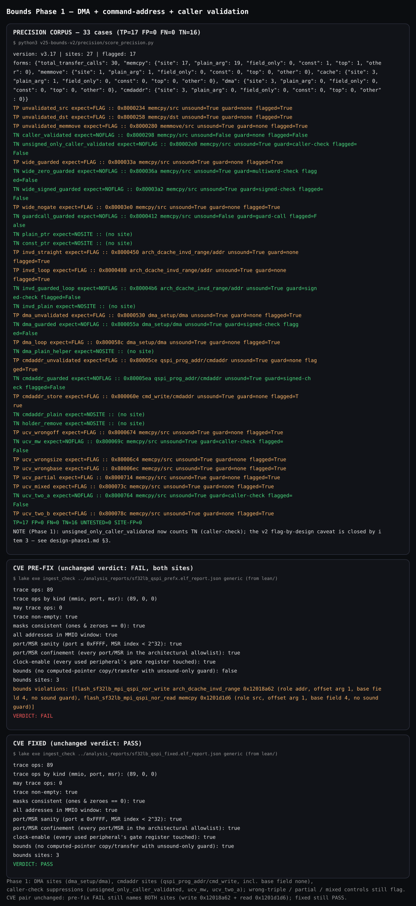
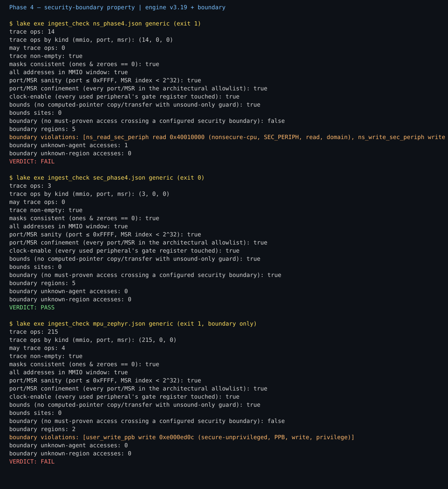

# Firmware Liberation Engine

   

Take a closed firmware binary, extract every hardware address it can touch,
and machine-check the result with Lean 4 — no execution, no guessing.

> **This is a static proof tool. It does not execute firmware and does not claim to find all vulnerabilities. PASS does not mean firmware is secure.**


No flashing, no unlocking, no device modification, no firmware uploads.

## Usage

```bash
bash setup.sh                                   # JDK + Ghidra + Lean (asks for your sudo password)
export FIRMWARE_WORKSPACE="$PWD"               # required: the built-in default is the dev VM's path
export PATH="$HOME/.elan/bin:$PATH"            # Lean tools live here; repeat in every new shell

# Blink test (small STM32 firmware, built by us — ships base64-encoded, decode first):
base64 -d targets/stm32_blink/stm32_blink.elf.b64 > stm32_blink.elf
python3 ingest_and_analyze.py stm32_blink.elf --no-upload
cd lean && lake exe ingest_check ../analysis_reports/stm32_blink.elf_report.json blink
# expect: trace ops 10, may trace ops 0, VERDICT: PASS (first Lean build takes 2-5 min)

# Big test (real firmware, Black Magic Probe v2.0.0):
cd ..
python3 ingest_and_analyze.py <path/to/blackmagic-native-v2_0_0.elf> --no-upload
cd lean && lake exe ingest_check ../analysis_reports/blackmagic-native-v2_0_0.elf_report.json generic
# expect: trace ops 447, VERDICT: PASS
cd lean && lake exe ingest_check ../analysis_reports/blackmagic-native-v2_0_0.elf_report.json bmp
# expect: VERDICT: PASS
```

Notes: the blink `.elf` ships base64-encoded (`targets/stm32_blink/stm32_blink.elf.b64`,
built from the `.c` next to it — the push tooling here is text-only, so the binary
itself is encoded). The BMP `.elf` does not ship — download
`blackmagic-native-v2_0_0.elf` from the official Black Magic Probe v2.0.0 release.
A binary passed as a path is used directly (no Drive needed); a bare name syncs via
`rclone` and needs a configured remote. `--no-upload` skips the report upload.
`FIRMWARE_WORKSPACE` and `GHIDRA_HEADLESS` env vars override paths.

## What it checks (Lean generic mode)

- **In-window addresses** — every fixed access inside the architecture's MMIO window.
- **Driver confinement** (bmp mode) — each driver family touches only its own peripherals.
- **Port/MSR confinement** — every port/MSR entry against an architectural allowlist.
- **Clock-enable-before-use** — every used STM32 peripheral's gate register touched.
- **Bounds** — no computed-pointer copy/transfer with an unsound-only guard.
- **Boundary** — no must-proven access crossing a configured security boundary
  (violation, unknown-agent and unknown-region counts reported, never silent).

## Results (extractor v3.23, 36-target regression, 0 mismatches)

| Target | Fixed findings | May | Lean verdict |
|---|---|---|---|
| Black Magic Probe v2.0.0 (ARM) | 447 MMIO | 7 sites | bmp PASS, generic PASS |
| Black Magic Probe, stripped | 327 MMIO | 5 sites | generic PASS only (never bmp mode on stripped input) |
| STM32F4 UART (-O0 / -O2) | 186 / 187 MMIO | 0 | generic PASS |
| nRF52 UART (-O3) | 220 MMIO | 0 | generic PASS |
| RP2040 hello_uart | 236 MMIO | 0 | generic PASS |
| TinyUSB cdc_msc (RP2040) | 324 MMIO | 0 | generic PASS |
| Zephyr echo_bot (nRF52840) | 282 MMIO | 0 | generic PASS |
| OVMF UEFI drivers (7 images) | 0 fixed MMIO · 28 ports | 0 | DxeCore / PciBus / PciHostBridge / QemuVideo PASS; Sata / Virtio FAIL (empty trace) |
| **Corpus total (6 stacks)** | **1,695** | | |

OVMF ports, PE+TE twin counted separately: DxeCore 11, PciBus 2, PciHostBridge 9,
QemuVideo PE 3 + TE 3 (25 counting the twin once). Lean sweep: 6 FAILs, all
pre-existing (Sata/Virtio empty traces + 4 intentional synthetic FAILs).

## What it proves, in one line each

- **CFG fixpoint tracker** resolves ARM MMIO addresses that never appear literally
  in the code (literal-pool load → register → STORE/LOAD); blink ground truth 10/10.
- **MAY analysis** (union join, capped sets) recovers path-dependent accesses as
  possible-address sets; BMP 7 sites.
- **Jump-table recovery** (TBB/TBH): BMP +22 must-accesses, 0 dropped.
- **Call-graph recovery** from pointer tables: 10 sites / 57 successors, 0 function-entry edges.
- **Points-to**: 159/178 CALLINDs resolved as may-sets; 19 unresolved, counted, never guessed.
- **Tail calls + literal scan**: field truth 116/116; 43 tail sites / 399 targets.
- **Per-site transfer, clobber refinement, stack slots**: BMP 235 → 427 across v3.9–v3.13.
- **Bounds**: synthetic precision TP=17, FP=0, FN=0, TN=16 (33 cases); CVE-2026-11743
  pre-fix FAILs naming both sites, fixed PASSes.
- **Boundary**: synthetic contract 16/16 (NS FAIL exactly 5, SEC PASS); Zephyr MPU
  trophy exactly 1 violation; SAU NS 5 / SEC 1.
- **Clock-enable**: synthetic violation FAILs exactly; blink/BMP/F4 PASS.

## Changelog (one line per version)

| Version | Change |
|---|---|
| v3.14 | Zephyr device-API resolver; Zephyr 127 → 196 (+69, zero lost); UARTE 0 → 65. |
| v3.15 | Bounds v1 (computed-pointer copies); CVE-2026-11743 pre-fix FAIL / fixed PASS (read site). |
| v3.16 | Bounds write path (cache-range transfers); pre-fix FAILs both sites; precision TP=6 FP=1 FN=0 TN=6. |
| v3.17 | Wide-check requires negative rejection; precision TP=8 FP=0 FN=0 TN=8; CVE pair unchanged. |
| v3.18 | Bounds Phase 1 (DMA, cmdaddr, caller-check); precision TP=17 FP=0 FN=0 TN=16 (33 cases). |
| v3.19 | Phase 3 coverage: 0x511 port, stripped Zephyr 97 → 156, SIO/SSI windows (RP2040 220, cdc_msc 303). |
| v3.20 | Boundary property V1 (PPB band, static profiles, SG veneers, DMA two-judgment); contract 16/16; Zephyr MPU trophy (1 violation); BMP core family fix. |
| v3.21 | V1.5: table learning + thread attribution built and proven (below); config-write learning design-only. |
| v3.22 | CpuDxe MSR allowlist gap closed (below); CpuDxe PASSes generic. |
| v3.23 | LocalApicTimerDxe + PlatformPei MSR allowlist gaps closed (below); both PASS generic. |
| v3.1–v3.13 | Fixpoint tracker, MAY analysis, jump tables, call graph, points-to, tail calls, per-site transfer, clobber refinement, stack slots. |

**v3.21 (V1.5) in short:** a table entry becomes a boundary region only when its
symbol is in a read-only block, some function directly CALLs a profile-declared
consumer, and that consumer's must-fixpoint resolves exactly to the table address
— otherwise zero regions, with the status recorded, never silent. Learned regions
sort below profile regions; supported layout is narrowly Zephyr 4.4 ARMv8-M
`arm_mpu_region` (no-PXN). Thread attribution resolves `k_thread_create` entry +
options from the caller-site fixpoint (K_USER → unprivileged), including a seeded
fixpoint rerun for compiler clones forwarding to `z_impl`. Config-write learning
with must-precede is **design-only**: the engine has no must-precede machinery, the
intra-function form would be vacuous on real targets, and Zephyr dynamic MPU
regions are reprogrammed every context switch — no order-free substitute was built.

**v3.22 (CpuDxe MSR allowlist) in short:** P5's CpuDxe MSR gap closed with four
named MSRs, each identified from Intel documentation — 0x17 IA32_PLATFORM_ID
(read), 0x79 IA32_BIOS_UPDT_TRIG (microcode trigger), 0x830 IA32_X2APIC_ICR (AP
bring-up), 0x982 IA32_TME_ACTIVATE (memory-encryption status) — and CpuDxe now
PASSes generic. Named entries only, no blanket range; the allowlist stays
index-granular, not direction-granular.

**v3.23 (LocalApicTimerDxe + PlatformPei MSR allowlist) in short:** the two
Step 2 confinement FAILs closed with five named MSRs, each identified from
Intel documentation — 0x3A IA32_FEATURE_CONTROL (SDM Vol 4 Table 2-2),
0x80F Spurious Interrupt Vector Register, 0x832 LVT Timer Register,
0x838 Initial Count Register for Timer, 0x83E Divide Configuration
Register for Timer (Intel x2APIC Specification 318148 Table 2-2; each
x2APIC index cross-checked as 0x800 + (xAPIC MMIO offset >> 4)) — and
both targets now PASS generic. Named entries only, no 0x800-0x8FF
blanket range; the allowlist stays index-granular, not
direction-granular. The Results header staleness (still reading v3.20)
is fixed to v3.23 in the same change.

**OVMF evaluation round (v3.23 Lean, counted):** 124 inventoried OVMF targets run — 51 PASS / 73 FAIL, all 73 FAILs empty-trace coverage (0 trace ops) with 0 real bugs and 0 bounds sites. Shell + TlsDxe needed a one-off 1G heap attempt (512M cap restored after); the 512M ceiling is no longer an open gap for this corpus.

## Honest limits (one line each)

- Generic PASS means only "what was found stayed in-window" — **not** proof of security.
- Stripped binaries: generic mode only — `bmp` mode passes vacuously on stripped input, never quote it.
- Clock-enable v1: order-free, not must-precede; register granularity, not bit; no-RCC firmware vacuous PASS.
- F4 USART2 invisible (Gap B, needs a redesign, not a patch); LPUART enable→disable→use not caught.
- OVMF fixed-band MMIO is an honest zero: UEFI drivers reach hardware via protocols and runtime BARs, not fixed addresses.
- Boundary V1.5 scope: static profiles + learned tables + thread attribution; config-write learning design-only; a boundary violation is a necessary condition for privilege escalation, NOT proof of an exploit.
- Non-live 21 (all-slots seeding) is DELIBERATELY NOT enabled — a finding must mean "does call", not "could call"; deferred until a labelled JSON shape exists.
- 16-bit real mode needs a raw-binary import path plus a segmented adapter; still open.
- Real violations found in shipped firmware: 0. The FAILs that exist are synthetic demos and Sata/Virtio's genuinely-empty traces; the MPU/SAU boundary violations are on purpose-built proof targets.
- PciHostBridge (resolved, not a finding): ports 0x510/0x514/0x518 are QEMU fw_cfg; the allowlist grants the four named ports only, and it now PASSES.

## Screenshots (real terminal output)

Terminal captures (SVG) of verbatim output from real runs — not mockups, not
diagrams. Binary PNGs cannot be pushed (the push tooling builds a UTF-8
snapshot), so the captures are rendered as SVG; the text inside each one is
copied byte-for-byte from the command shown, and the helper scripts live
next to the captures.


Fresh `lake exe ingest_check ../analysis_reports/zephyr_v314.elf_report.json generic` (run from `lean/`): trace 196, clock-enable true, VERDICT: PASS.


Computed from the v3.13 baseline and v3.14 Zephyr report JSONs (`python3 assets/screenshots/zephyr_before_after.py`, run from the repo root): 127 → 196, UARTE layer 0 → 65, gain +69 with zero losses.


Fresh recount of the v3.14 regression log (`python3 assets/screenshots/regress_check.py`, run from the repo root): 36 targets checked, 0 mismatches.


v3.15 bounds verdict on CVE-2026-11743 firmware (`lake exe ingest_check <report> generic`, run from `lean/`): pre-fix FAILs naming the vulnerable read site (`flash_sf32lb_mpi_qspi_nor_read memcpy 0x1201d1d6, no sound guard`); fixed firmware (909eb56) PASSes with the same site guarded (`signed-check`).


v3.16 bounds verdict on the same CVE pair: pre-fix FAILs naming BOTH the read site (memcpy) and the write site (`flash_sf32lb_mpi_qspi_nor_write arch_dcache_invd_range 0x12018a62, no sound guard`); fixed firmware PASSes with both sites guarded.


v3.17 bounds verdict on the same CVE pair (unchanged: pre-fix FAILs naming BOTH sites, fixed PASSes), plus the refined precision pane: `wide_guarded` flagged again (sign-extending, no negative rejection), zero-extending and signed+wide cases unflagged, TP=8 FP=0 FN=0 TN=8.


v3.18 bounds Phase 1 on the same CVE pair (unchanged: pre-fix FAILs naming BOTH sites, fixed PASSes), plus the extended precision pane: 33 cases, TP=17 FP=0 FN=0 TN=16 — DMA sites, cmdaddr sites (including `base field none`), and caller-check suppressions, with wrong-triple / partial / mixed callers still flagging.


v3.20 Phase 4 boundary verdicts (`lake exe ingest_check <report> generic`, run from `lean/`): synthetic nonsecure image FAILs with exactly 5 violations, secure image PASSes, and the Zephyr MPU + userspace target FAILs only on boundary with exactly 1 violation (`user_write_ppb` write 0xE000ED0C, privilege leg).

## Project layout

```
ExtractIR.java            # the extractor (Ghidra script)
ingest_and_analyze.py     # one-command pipeline: binary -> report JSON
classify_mmio.py          # local-vs-target classifier + chip profiles
svd_import.py             # CMSIS-SVD -> chip profile JSON
elf_strip.py              # stripped-binary reproduction helper
lean/                     # Lean 4 verifier (lake exe ingest_check)
loaders/te/               # custom Ghidra TE ("VZ") image loader, v1
targets/                  # fixtures built from public source (.c + .elf.b64)
docs/                     # static reports site (GitHub Pages, /docs)
assets/                   # README images
assets/screenshots/       # terminal captures (SVG, verbatim real output) + helper scripts
*_profile.json            # chip peripheral profiles (hand + SVD-derived)
setup.sh                  # JDK + Ghidra + Lean install
```

## License

MIT — see [`LICENSE`](LICENSE).
